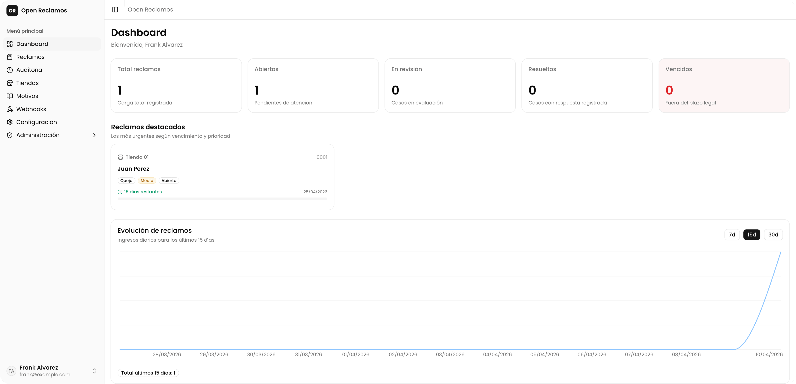

# Open Reclamos



Sistema open source para crear y gestionar **Libros de Reclamaciones Virtual** alineado con las regulaciones de INDECOPI (Perú).

Open Reclamos permite a cualquier empresa implementar un Libro de Reclamaciones Virtual en su sitio web de forma sencilla, cumplir con la normativa del Código de Protección y Defensa del Consumidor, y gestionar los reclamos de sus clientes desde un panel administrativo.

## Desarrollo

### Prerrequisitos

- [Bun](https://bun.sh)
- [Go](https://go.dev) 1.26 o superior

Por defecto usa SQLite y guarda los archivos en disco, así que no necesitas nada más para empezar. PostgreSQL, SMTP, S3 y la consulta de documentos (ApiPeruDev) son opcionales y se configuran en el `.env`.

### Configuración

1. Copia el archivo de variables de entorno:

```bash
cp .env.example .env
```

2. Instala las dependencias, genera el código y prepara la base de datos:

```bash
bun install
bun run generate
bun run db:migrate
bun run db:seed
```

3. Levanta el backend y el frontend en terminales separadas:

```bash
bun run dev:api
bun run dev:web
```

Y listo, la app estará corriendo en [http://localhost:5173](http://localhost:5173). La primera vez, entra a `/install` para crear el administrador.

## Licencia

[MIT](LICENSE)
